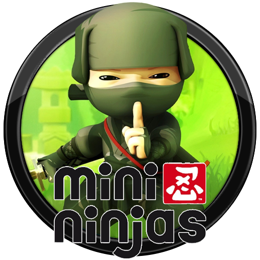

# Mini Ninjas NX

<p align="center"></p>

A native Nintendo Switch port of the Xbox 360 version of **Mini Ninjas**.
The PowerPC game code is statically recompiled to AArch64 with
[ReXGlue](https://github.com/rexglue/rexglue-sdk), with a native
[deko3d](https://github.com/devkitPro/deko3d) renderer.

This is an independent research project. Bring your own supported Xbox 360
copy. The original game executable, models, textures, levels, audio and movies
are not included. The release contains the port executable and the shader
program package needed by its renderer; see [distribution contents](docs/installing.md#distribution-contents).

## Install

1. Open the **[Mini Ninjas NX installer](https://infriker.github.io/mini-ninjas-nx/)**.
2. Select your Xbox 360 ISO or extracted game folder containing `default.xex`,
   `scenes/` and `movies/`.
3. Create `mini-ninjas-nx.zip` and extract it into `sdmc:/switch/`.
4. Launch `mini-ninjas.nro` in **title takeover mode**: hold **R** while
   launching an installed game, then choose Mini Ninjas NX in the Homebrew Menu.

The installer checks the supported executable and packages your files locally
in the browser. **Game files are never uploaded.** Album/applet mode does not
provide enough memory. The Windows PC version is not supported.

```text
/switch/mini-ninjas/
  mini-ninjas.nro
  minininjas.toml
  minininjas_shaders.dslib
  shadercache_dksh.bin
  game/
    default.xex
    scenes/
    movies/
    ...
```

To update an existing v1.0.3 or v1.0.4 installation, replace
`sdmc:/switch/mini-ninjas/mini-ninjas.nro` with the NRO from the
[latest release](https://github.com/infriker/mini-ninjas-nx/releases/latest).
For manual installation and save locations, see [installation](docs/installing.md).

## Performance

The v1.0.5 release uses a gameplay profile recorded on Switch. Audio workers
can sleep while waiting for each other, and frequently executed game routines
keep PowerPC register values in host registers. Both changes are enabled by
default. The renderer submits work to the GPU every 128 guest draws by default.
See [performance settings](docs/performance.md) for the individual controls.

On Nintendo Switch, gameplay runs at **25–30 FPS at stock clocks**, depending
on the scene. For a stable **30 FPS**, set the CPU to **1224 MHz** and keep
the default 30 FPS limit. For **60 FPS**, set the CPU to **1785 MHz** and the
GPU to **614 MHz**, then set `minininjas_fps_limit = 0` in `minininjas.toml`
beside the NRO and restart the game.
See [frame-limit settings](docs/installing.md#frame-limit).

- Main scene rendered at **1280×720** with **hardware 4× MSAA**.
- One full-screen scene region instead of the original four 320-pixel strips.
- Reused vertex/index uploads and bindings, faster command processing and
  optimized generated CPU calls.
- Debug overlays, service shortcuts, periodic profiling and raw shader dumps
  are disabled or removed from the release.

In the same title scene, the single-region change reduced renderer draw calls
from **546 to 147 per frame** and copies from **10 to 4**. This is a draw-call
comparison, not a claim of a 73% gameplay FPS increase. Details are in
[performance](docs/performance.md).

## Controls

Switch face buttons follow their printed letters, matching Xbox prompts.

| Switch | Xbox 360 input |
|---|---|
| A / B / X / Y | A / B / X / Y |
| ZL / ZR | LT / RT |
| L / R | LB / RB |
| + / − | Start / Back |
| Left / right stick | Movement / camera |
| Stick clicks and D-pad | LS / RS and D-pad |

## Build and documentation

| Document | Contents |
|---|---|
| [Building](docs/building.md) | Pinned SDK, Docker environment, code generation and NRO build |
| [Installation](docs/installing.md) | Manual setup, updates and saves |
| [Porting notes](docs/porting.md) | The changes and reference projects that made the port work |
| [Performance](docs/performance.md) | Rendering and CPU optimizations |
| [Relinking](docs/RELINKING.md) | Rebuilding with modified runtime libraries |
| [Installer](installer/README.md) | Browser packaging and GitHub Pages |

Supported Xbox 360 executable, Title ID **534307E4**:

```text
default.xex SHA-256
2747afb17badc9832ca6fbc8d06ddb309b23205410902180b525a5373c8bdce6
```

Only this executable revision is currently supported.

## Credits

- **IO Interactive and the original Mini Ninjas development and publishing teams.**
- [Tom Clay / ReXGlue](https://github.com/rexglue/rexglue-sdk) and
  [Xenia contributors](https://github.com/xenia-project/xenia) — recompilation,
  Xbox 360 runtime and research foundations.
- [nx-mod / rexglue-sdk-nx](https://github.com/nx-mod/rexglue-sdk-nx) — Switch
  runtime, toolchain integration and deko3d rendering foundation.
- [VasilkovND](https://github.com/VasilkovND) —
  [Dante's Inferno NX](https://github.com/VasilkovND/dantes-inferno-nx), the
  starting point for the game-specific command reader, shader loading and CPU
  helper optimization tools; [Dead Space 2 NX](https://github.com/VasilkovND/ds2-nx)
  and the earlier work credited by those projects.
- [StevensND / NFSMW-NX](https://github.com/StevensND/nfsmw-nx) — rendering and
  game render-mode references, and the browser-installer lineage.
- [R-drg / Project8 SW](https://github.com/R-drg/project8-sw) and
  [F.E.A.R. NX](https://github.com/infriker/fear-nx) — browser installer
  architecture; F.E.A.R. NX also provided the Eden buffer-descriptor fix.
- [MarathonRecomp](https://github.com/sonicnext-dev/MarathonRecomp) — reference
  for coordinating full-size render targets, a single region and resolves.
- [hedge-dev / XenosRecomp](https://github.com/hedge-dev/XenosRecomp),
  [SPIRV-Cross](https://github.com/KhronosGroup/SPIRV-Cross),
  [DirectX Shader Compiler](https://github.com/microsoft/DirectXShaderCompiler)
  and the uam contributors — shader translation and compilation.
- [devkitPro](https://devkitpro.org/), [deko3d](https://github.com/devkitPro/deko3d)
  and [switchbrew/libnx](https://github.com/switchbrew/libnx).
- [centollOS / SwitchWakerHD](https://github.com/centollOS/SwitchWakerHD) —
  the patched uam source used by the SDK's Switch shader compiler.

See [NOTICE](NOTICE), [LICENSES](LICENSES) and
[installer notices](installer/NOTICES.md) for component licenses and attribution.
The port's adaptation code is licensed under [GPL-3.0](LICENSE); individual
dependencies retain their own licenses. Game code and artwork are not relicensed
by this repository. This project is not affiliated with or endorsed by Nintendo,
Microsoft, IO Interactive or the game's publishers.
